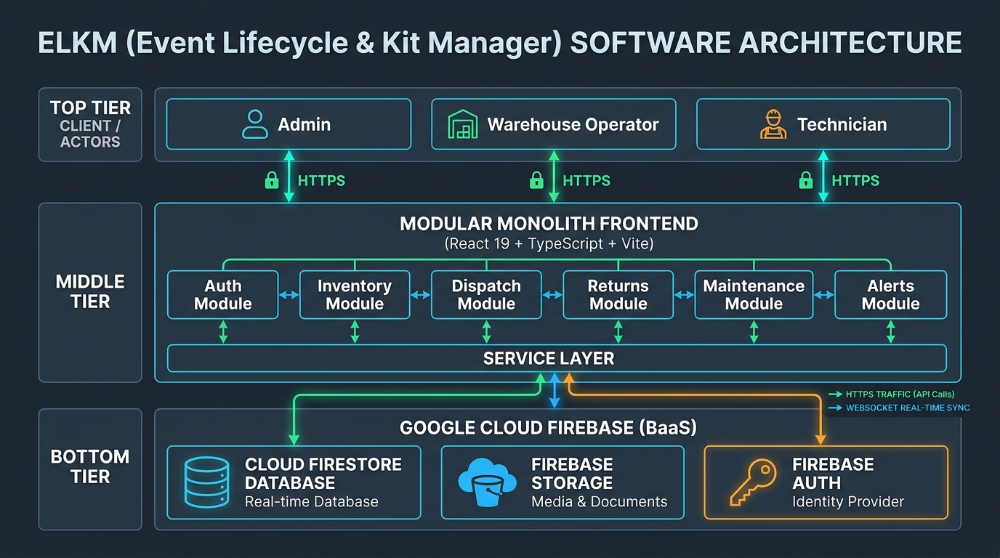
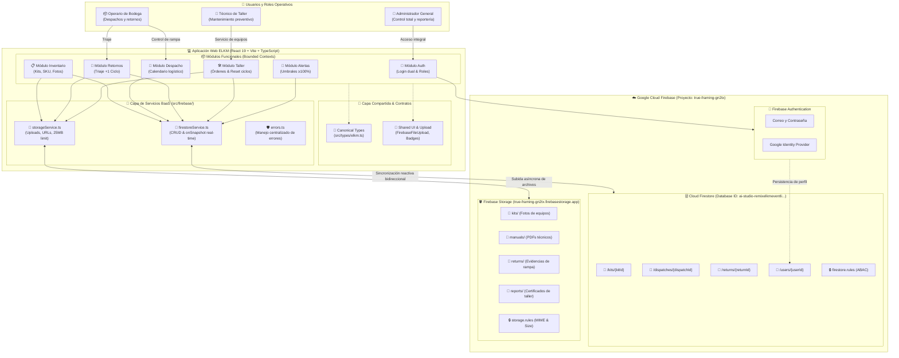
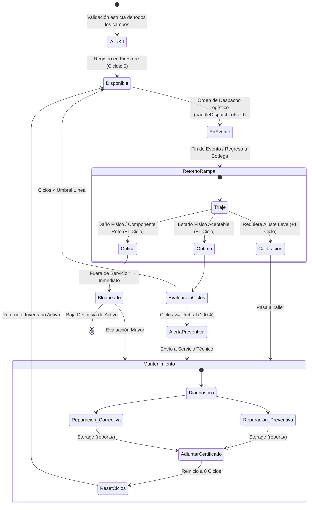

# Diagrama de Arquitectura del Sistema ELKM
**Event Lifecycle & Kit Manager · Proyecto Arquitectura de Software**

- **Autores:** Sebastián Jiménez Mena (202320048) & Samuel David Quintana (202310319)
- **Tipo de Arquitectura:** Monolito Modular con Backend-as-a-Service (BaaS) en Google Cloud Firebase
- **Patrón de Código:** Arquitectura por Capas (Presentación &rarr; Dominio &rarr; Servicios BaaS)

---

## 🖼️ Diagrama Gráfico Oficial de Arquitectura



*Diagrama de 3 Tiers: Actores &rarr; Monolito Modular Frontend (React 19) &rarr; Google Cloud Firebase BaaS (Firestore, Storage, Auth).*

---

## 1. Diagrama de Contenedores y Componentes (C4 Nivel 2 y 3)

Este diagrama modela la estructura completa del sistema: los roles de usuario, la aplicación web cliente dividida en módulos de dominio, la capa de servicios desacoplados y los servicios administrados en Google Cloud Firebase.



---

## 2. Diagrama de Flujo de Negocio: Ciclo de Vida del Kit (ELKM Engine)

Este diagrama representa la máquina de estados y las reglas de negocio del kit a través de los eventos de la bodega:



---

## 3. Diagrama de Arquitectura en Bloques (Vista ASCII / Universal)

Para visualización directa en terminales o editores de texto sin extensiones gráficas:

```text
======================================================================================================
                                       ARQUITECTURA DEL SISTEMA ELKM
======================================================================================================

 [USUARIOS] ----> [Administrador]       [Operario de Bodega]       [Técnico de Mantenimiento]
                         |                       |                              |
                         +-----------------------+------------------------------+
                                                 |
                                                 v  (Navegador Web / HTTPS)
 +--------------------------------------------------------------------------------------------------+
 | FRONTEND: MONOLITO MODULAR (React 19 + TypeScript + Vite + Tailwind CSS)                        |
 |                                                                                                  |
 |  [Capa de Presentación / Bounded Contexts]                                                       |
 |  +--------------------+  +--------------------+  +--------------------+  +---------------------+ |
 |  |    modules/auth    |  | modules/inventory  |  |  modules/dispatch  |  |   modules/returns   | |
 |  | (Login/Register)   |  | (Kits / SKUs)      |  | (Calendario/Órden) |  | (Triaje +1 Ciclo)   | |
 |  +--------------------+  +--------------------+  +--------------------+  +---------------------+ |
 |  +--------------------+  +--------------------+  +--------------------+                          |
 |  |modules/maintenance |  |   modules/alerts   |  |    modules/docs    |                          |
 |  | (Taller / Records) |  | (Umbrales >=100%)  |  | (ADRs / Diagramas) |                          |
 |  +--------------------+  +--------------------+  +--------------------+                          |
 |                                                                                                  |
 |  [Capa Compartida y Contratos de Dominio]                                                        |
 |  * src/types/elkm.ts (Kit, DispatchEvent, ReturnLog, UserProfile, ServiceRecord)                 |
 |  * src/shared/components/FirebaseFileUpload.tsx (Drag & Drop, Barra de Progreso)                |
 |                                                                                                  |
 |  [Capa de Servicios BaaS / Acceso a Datos]                                                      |
 |  * src/firebase/firestoreService.ts (subscribeKits, saveKit, updateDispatch, saveReturnLog)       |
 |  * src/firebase/storageService.ts (uploadFileToFirebaseStorage, getDownloadURL)                  |
 |  * src/firebase/errors.ts (Mapeo centralizado de códigos de error y fallbacks seguros)           |
 +-----------------------------------------------+--------------------------------------------------+
                                                 |
                                (SDK Firebase Web v11 / TLS 1.3)
                                                 |
                                                 v
 +--------------------------------------------------------------------------------------------------+
 | BACKEND-AS-A-SERVICE: GOOGLE CLOUD FIREBASE (Proyecto: true-framing-gn2tx)                      |
 |                                                                                                  |
 |  [Firebase Authentication]              [Google Cloud Firestore]         [Firebase Storage]     |
 |  * Correo / Contraseña                  * BD ID: ai-studio-remixelkm...  * true-framing-gn2tx...|
 |  * Google Identity Provider             * Colección /kits/               * Carpeta /kits/       |
 |  * Token JWT + Roles en Firestore       * Colección /dispatches/         * Carpeta /manuals/    |
 |                                         * Colección /returns/            * Carpeta /returns/    |
 |                                         * Colección /users/              * Carpeta /reports/    |
 |                                         * Reglas ABAC (firestore.rules)  * Reglas storage.rules |
 +--------------------------------------------------------------------------------------------------+
======================================================================================================
```

---

## 4. Visualización Nativa en el Sistema

El diagrama de arquitectura y el diagrama de ciclo de vida del kit se encuentran integrados de forma nativa e interactiva directamente dentro del aplicativo ELKM:
- Se consulta en la aplicación haciendo clic en **"Arquitectura"** (barra superior) o **"Ficha Técnica y Arquitectura"** (pie de página).
- Cuenta con conmutador dinámico de vistas para alternar entre el modelo por capas (C4) y la máquina de estados del ciclo de vida del kit.

